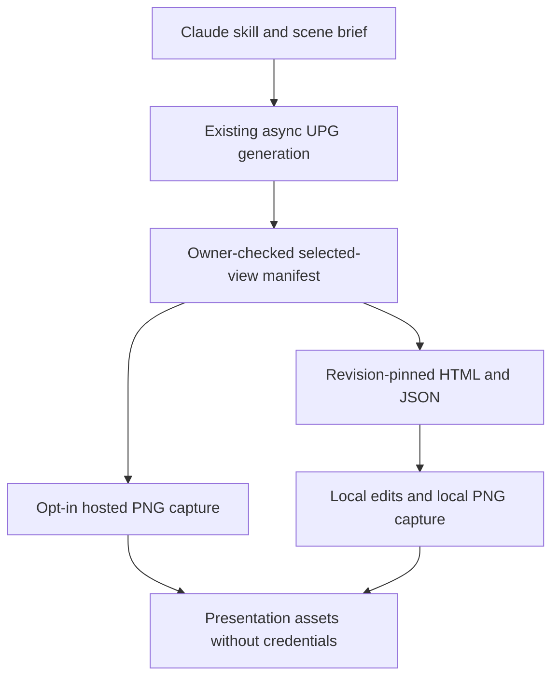

# Claude presentation artifacts: implementation plan

Rollback: `rollback/pre-claude-artifacts-2026-10-24` → `7ca4b35`.
No changes to original/preview editors, generated layout, authentication flows or
shared Accounts schema. No paid service is added. TaskCreate/TaskUpdate are not
available in this session; this checklist tracks implementation state.

## Phase 1 — additive backend foundation

- [x] Inspect generation, authorization, export and deployment contracts.
- [x] Push rollback tag before implementation.
- [x] Add versioned, allowlisted selected-view JSON and an artifact manifest.
- [x] Pin downloads to a selected-view revision; reject a changed revision.
- [x] Reuse owner-checked Accounts export-state authorization on every request.
- [x] Add metadata-only MCP artifact discovery and a local download helper.
- [x] Add isolated, bounded PNG capture with explicit runtime capability gating.
- [x] Test authorization, privacy, selectors, deadlines, capacity and regressions.
- [x] Prepare tested backend-only release for the established auto-push workflow.

Existing durable async generation remains the source of saved profiles. The new
stateless artifact layer selects a saved persona, projects only render fields,
and returns authenticated HTML, selected-view JSON or a fixed 1920×1080 PNG.
It never accepts arbitrary caller HTML or executes caller commands. HTML and
JSON are the editable handoff; edits made locally do not update the cloud project.

### Artifact handoff

## Phase 2 — operational rendering and Claude connection

- [ ] Verify a supported, sandboxed Chromium runtime on Heroku Fir or an approved
  internal render worker; configure `UPG_CAPTURE_EXECUTABLE_PATH` only afterward.
- [ ] Verify final hosted B2C/B2B captures, image readiness and typography.
- [ ] Validate the chosen Claude client's network and API-key/MCP connectivity.
- [ ] Prove the complete URL → generation → selected artifacts → 3D scene handoff.

The current Fir build uses only Node/procfile buildpacks and has no Chromium.
Installing the control library alone does not make PNG production-ready. Until
configured, HTML/JSON work while PNG returns an explicit 503. Browser verification
outside preview tools requires the user's repository-policy exception.

## Boundaries and scale

1. Claude directs content using existing generation URL/persona/brief inputs.
2. Accounts retains ownership, scoped API credentials and durable generation jobs.
3. UPG manifests expose download paths, never credentials or inline multi-MB MCP
   payloads. Each download reauthorizes the caller. Data uses a render-field
   allowlist, excluding API settings, local drafts and unrelated persona state.
4. Artifact revision pins cover selected render data and renderer version; clients
   use one revision for HTML, JSON and PNG. A changed project produces a 409, not
   a silently mixed presentation. No cross-request private cache is introduced.
5. Initial capture is on demand, at most one browser per process, no unbounded
   waiting queue. It is not a durable render job. Timeouts/capacity failures retry
   rendering only; they must never restart paid generation.
6. Capture rejects external assets initially. Generated/embedded assets work;
   manually linked assets must be embedded first. Browser egress is denied,
  credentials are never supplied to the browser, and document scripts are removed
  and forbidden by CSP (automation scripting remains available for readiness).
7. Higher throughput should add an owner-scoped durable render queue plus private
   artifact storage keyed by owner/project revision/persona/renderer/viewport.
   This is a later capacity enhancement, not a new database prerequisite now.
8. Private Heroku/SSO reachability is separate from UPG API authentication. No
   public gateway, tunnel or Salesforce access bypass is created by this change.

## Acceptance

No frontend baseline change; old generation/export/MCP clients remain supported;
foreign/missing/revoked keys cannot get artifacts; invalid selectors fail closed;
JSON drops unknown properties at all levels; PNG dimensions are fixed and image
failures explicit; browser failure leaves normal UPG generation/editing intact.
Record actual tests and deployment outcomes below before handoff.

## Verification so far

- Full UPG regression suite: **234 passed, no failures/skips**. Production frontend
  hash baselines are unchanged; no builder, preview or standalone rebuild was needed.
- Real approved local Chromium: B2C and B2B 1920×1080 PNGs, inline images decoded,
  no browser network, nonblank output; screenshots visually inspected.
- Independent review: no auth/SSRF/credential bypass found. Revision hashing now
  includes rendered HTML bytes, so embedded-asset-only changes invalidate manifests.
- Capture cleanup review fixed: capacity stays reserved until confirmed browser
  teardown, including late launches after timeouts. Hung/failed teardown cannot
  spawn additional browsers and requires restarting that render process.
- Local download helper verified against forged download links, changed revisions,
  output overwrite, secret leakage, and explicit HTML/JSON-only operation.
- New `playwright-core` dependency is pinned to 1.64.1. No browser download or
  paid service is bundled. Existing dependency audit reports four findings in
  Express/body-parser/proxy-addr/qs; no new finding is attributed to Playwright.
- Remote images intentionally fail closed for hosted capture rather than launch
  a second unrestricted fetch path. Existing rendered HTML exports are unaffected.
